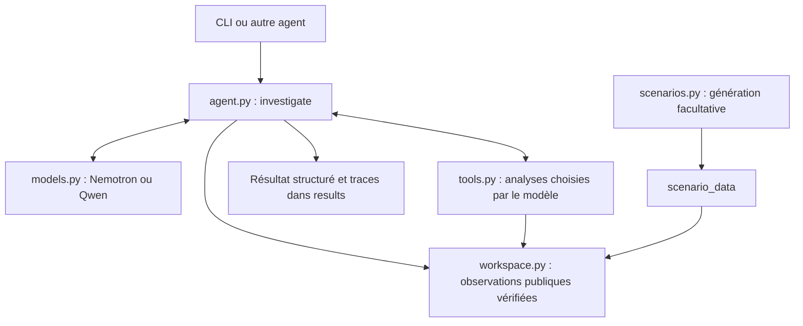

# Agent d’investigation MLOps

Un agent LangChain examine une alerte, choisit ses outils et rend un diagnostic.
Il utilise Nemotron via NVIDIA ou Qwen via Ollama local. Aucun contrôleur ne valide,
ne refuse ou ne remplace sa conclusion pendant l’investigation.

## Architecture : 7 fichiers Python

```text
PI_DS/
├── mlops_churn/
│   ├── __init__.py     # Interface Python : investigate, generate_scenarios
│   ├── __main__.py     # Commande unique : investigate / generate / check
│   ├── agent.py        # Instructions, boucle LangChain, mémoire, preuves, résultat
│   ├── models.py       # NVIDIA et Ollama, clé, transport et mesures de durée
│   ├── tools.py        # Calculs analytiques et comparaison des versions
│   ├── workspace.py    # Catalogue public, copies et vérifications SHA256
│   └── scenarios.py    # Données synthétiques, scénarios, modèle ML et alertes
├── configs/            # nemotron.json et local.json : paramètres des modèles
├── scenario_data/
│   ├── demo/           # Les 5 épisodes déjà disponibles + référence commune
│   └── generated/      # Nouveaux lots, créés seulement sur demande
├── tests/              # 4 fichiers : agent, outils, modèles et scénarios
├── results/            # Un dossier par nouvelle investigation ; effaçable
├── .env                # Clé NVIDIA locale
├── .venv-agent/        # Environnement Qwen local conservé
└── .venv-cloud/        # Environnement Nemotron conservé
```

Les anciens lanceurs de trois lignes, le contrôleur, le mode Docker et les
adaptateurs inutilisés ont été retirés. Les calculs statistiques et les mécanismes
de génération sont conservés. Les dépendances et leurs fichiers de verrouillage
restent séparés pour pouvoir reproduire les deux environnements.

## Coordination d’une investigation



1. `__main__.py` lit la commande ; un autre agent peut appeler directement `investigate`.
2. `workspace.py` copie les observations autorisées et enregistre leurs empreintes.
   Les fichiers de vérité de simulation ne sont jamais copiés dans ce catalogue.
3. `agent.py` transmet l’alerte et le catalogue au modèle fourni par `models.py`.
4. Le modèle choisit les appels natifs. `tools.py` exécute les calculs sur les
   fichiers complets ; chaque opération reçoit un identifiant de preuve `E0001`, etc.
5. `agent.py` conserve les résultats, rappelle la mémoire et le budget, puis renvoie
   la réponse finale brute et son objet JSON. Une réponse sans outil termine l’enquête.
6. `--evaluate`, facultatif, compare la cause à la vérité synthétique **après** la fin,
   sans nouvelle requête ni retour au modèle. Cette comparaison reste dans la CLI.

Les dix outils sont `inspect_files`, `describe_resource`, `check_data_quality`,
`compare_tables`, `compare_distributions`, `evaluate_predictions`, `compare_windows`,
`inspect_deployment`, `compare_conditional_relationship` et `compare_model_versions`.
Les outils n’effectuent aucune correction des données ni aucun réentraînement.

## Exécuter avec les environnements conservés

Depuis le dossier du projet, dans PowerShell :

```powershell
# Une seule question : consomme un appel NVIDIA
.\.venv-cloud\Scripts\python.exe -m mlops_churn check --provider nvidia

# Investigation Nemotron sur un épisode déjà disponible
.\.venv-cloud\Scripts\python.exe -m mlops_churn investigate --scenario concept_drift

# Comparaison facultative à la vérité, seulement après la fin
.\.venv-cloud\Scripts\python.exe -m mlops_churn investigate --scenario deployment_regression --evaluate

# Modèle local : démarrer Ollama avant cette commande
.\.venv-agent\Scripts\python.exe -m mlops_churn investigate --provider local --scenario concept_drift
.\.venv-agent\Scripts\python.exe -m mlops_churn check --provider local
```

Scénarios disponibles : `data_drift`, `concept_drift`, `data_corruption`,
`deployment_regression`, `false_alert`. `--scenario all` les lance successivement.
Les investigations NVIDIA consomment des appels ; la génération et les tests
automatisés n’en consomment aucun.

La clé est conservée dans `.env`. Pour la changer sans terminal, ouvrir ce fichier
dans l’éditeur et remplacer la valeur de `NVIDIA_API_KEY`. Pour une installation
neuve, copier `.env.example` vers `.env` puis renseigner la clé.

`configs/nemotron.json` conserve le modèle
`nvidia/nemotron-3.5-super-vl-120b-a12b`, le raisonnement et les budgets actuels :
12 appels au modèle, 16 appels d’outils. `configs/local.json` conserve
`qwen3:8b-q4_K_M`. Les environnements et les modèles Ollama installés sont conservés.

## Générer de nouveaux scénarios

```powershell
.\.venv-cloud\Scripts\python.exe -m mlops_churn generate --scenario all --seed 100001
.\.venv-cloud\Scripts\python.exe -m mlops_churn generate --scenario data_drift --seed 120001
```

Chaque scénario crée un dossier distinct sous `scenario_data/generated/`, dont le
chemin est affiché. Pour utiliser un dossier généré :

```powershell
.\.venv-cloud\Scripts\python.exe -m mlops_churn investigate --scenario data_drift --experiment "scenario_data/generated/NOM_DU_DOSSIER"
```

Chaque scénario contient 500 clients et deux fenêtres de confirmation. Le modèle
de référence, la population de référence et la calibration sont copiés sans changement.
La génération ne réentraîne pas le modèle prédictif.

| Scénario | Mécanisme synthétique |
|---|---|
| Data drift | Sélection d’une population près de la frontière du modèle, sans sélectionner sur les labels |
| Concept drift | Inversion du signe du logit générant la cible ; génération de X inchangée |
| Data corruption | Multiplication de `monthly_charges` par 100 entre source et entrées |
| Deployment regression | Inversion des coefficients et de l’interception de la version servie |
| False alert | Sélection d’un lot normal franchissant le seuil, parmi au maximum 1 000 candidats |

La graine de génération change les données. `seed` dans les profils du modèle
concerne son échantillonnage. Les graines initiales conservées sont 81001, 80001,
83001, 85001 et 90011, respectivement. La vérité et les détails des injections
restent réservés à `evaluation/`, jamais fournis au modèle.

## Intégration avec les autres agents

Depuis le projet ou un environnement où le projet est installé en mode éditable :

```python
from mlops_churn import investigate

result = investigate(
    episode_dir="scenario_data/demo/episodes/episode-004",
    reference_dir="scenario_data/demo",
    provider="nvidia",              # ou "local"
    output_dir="results",
    options={"max_model_calls": 12, "max_tool_calls": 16},
    on_event=lambda event: print(event["event"]),  # facultatif
)

print(result["status"])
print(result["final_diagnosis"])
print(result["duration_seconds"])
print(result["remaining_model_calls"])
```

L’appel est synchrone et renvoie un dictionnaire sérialisable en JSON. `model=`
permet aussi de fournir un modèle LangChain existant acceptant `bind_tools`.
Les événements sont `model_started`, `tool_completed` et `investigation_completed`.
Les callbacks d’outils peuvent être appelés depuis plusieurs threads si le modèle
demande plusieurs analyses dans une décision.

Le dossier d’incident peut porter n’importe quel nom et venir d’un autre agent.
Il doit respecter le contrat suivant :

```text
reference_dir/
├── reference_data.csv          # Référence étiquetée
└── models/reference.joblib     # Bundle prédictif de confiance

episode_dir/
├── alert.json
├── context.json                # Historique, seuil et empreintes des versions
├── active.joblib               # Bundle actif de confiance
├── focus/
│   ├── source.csv              # customer_id + caractéristiques avant transformation
│   ├── inputs.csv              # customer_id + caractéristiques effectivement servies
│   ├── predictions.csv         # customer_id, probability, prediction, model_version
│   ├── feedback.csv            # customer_id, churn
│   └── monitoring.json
└── confirmation-*/monitoring.json  # Confirmations disponibles, facultatives
```

`context.json` contient `deployment.reference_version` et `deployment.active_version`
au format `sha256:EMPREINTE`. Les bundles contiennent `pipeline`, `features` et
`threshold`. Utiliser les fichiers conservés comme exemples de schéma.
Les modèles chargés sont des artefacts locaux de confiance ; aucun chemin de modèle
arbitraire n’est accepté dans un appel d’outil. Aucun dossier `evaluation/` n’est
nécessaire pour l’intégration.

Le résultat contient notamment `status`, `final_diagnosis`, `raw_final_text`,
`evidence`, `duration_seconds`, `model_calls`, `tool_calls`, `usage`, les budgets
restants, `originals_preserved`, `run_directory` et `error`. `completed` signifie
que le modèle a terminé avec un diagnostic JSON exploitable, pas que sa cause
a été validée scientifiquement. Les erreurs de préparation sont levées ; les
erreurs de la boucle d’investigation sont conservées dans le résultat.

## Sorties et vérifications

Chaque exécution crée un seul dossier `results/DATE-IDENTIFIANT/` :
`result.json`, `final_response.md`, `trace.json`, `evidence.json`, `memory.json`,
`initial_observations.json`, `setup.json`, `runtime.json`, les échanges de transport
et une copie des observations publiques. Aucun historique d’expériences n’est
nécessaire au fonctionnement ; `results/` peut être vidé.

```powershell
.\.venv-cloud\Scripts\python.exe -m unittest discover -s tests -v
.\.venv-agent\Scripts\python.exe -m unittest discover -s tests -v
```

Ces tests vérifient les calculs, l’intégrité, la génération des cinq scénarios,
les connecteurs sans réseau et la boucle agent/outils avec un modèle simulé.
Ils ne mesurent ni la qualité actuelle de Nemotron ni sa latence réseau. Le test
du connecteur NVIDIA est ignoré lorsque cette dépendance manque dans l’environnement local.

Pour reconstruire les environnements sur un autre PC, utiliser
`requirements-agent.lock.txt` ou `requirements-nvidia.lock.txt` dans des environnements
séparés. Les fichiers `requirements-agent.txt` et `requirements-nvidia.txt` indiquent
les dépendances directes ; `requirements.txt` contient la pile scientifique commune.
