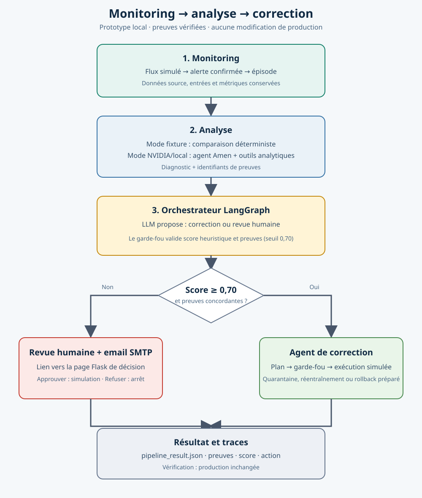

# Agent de correction MLOps — V3



## Ce que contient la V3

- **LangGraph**: workflow `plan -> guard -> execute -> verify`.
- **LLM optionnel**: plan structuré via `ChatOpenAI` (ou endpoint compatible OpenAI).
- **Baseline**: mode `rules` sans API.
- **Garde-fous**: décision LLM incompatible avec le diagnostic -> `human_review`.
- **Outils**: clôture/quarantaine simulées, préparation de réentraînement/rollback; aucune modification de production.
- **Traces**: `artifacts_v3/agent_traces.jsonl`.
- **Tests**: 5 incidents, y compris confiance faible, et tentative LLM interdite.

## Installation — PowerShell VS Code

```powershell
.\.venv\Scripts\Activate.ps1
python -m pip install -r requirements.txt
python demo_v3.py --mode rules
python -m unittest -v test_v3.py
```

## Activer le vrai LLM

Dans PowerShell, uniquement si vous disposez d'une clé API valide :

```powershell
$env:OPENAI_API_KEY = "VOTRE_CLE_API"
$env:OPENAI_MODEL = "gpt-4o-mini"
python demo_v3.py --mode llm
```

Pour un service compatible OpenAI, définir aussi `OPENAI_BASE_URL` et le nom de modèle approprié.
**Ne jamais committer une clé API.** Des coûts d'API peuvent s'appliquer.

## Tester le flux complet

Depuis `mlops_correction_agent_groq`, le mode `fixture` lance le monitoring réel
et compare les fichiers `source` et `inputs` avec l'outil analytique. Sur le scénario
`data_corruption`, cette vérification permet de tester une mise en quarantaine simulee,
sans appeler de LLM et sans modifier la production.

```powershell
..\.venv-correction\Scripts\python.exe -m pip install -r requirements-integration.txt
..\.venv-correction\Scripts\python.exe pipeline_v4.py --scenario data_corruption --analysis-mode fixture
..\.venv-correction\Scripts\python.exe -m unittest -v test_v3.py test_pipeline_v4.py test_orchestrator_v4.py test_human_notifications.py
```

Le score de confiance est une heuristique de corroboration, pas une probabilité
calibrée : l'action exige une preuve citée, un outil cohérent avec la cause et une
alerte confirmée. Un score faible ou une preuve incohérente déclenche `human_review`.
Le résultat est affiché dans le terminal et sauvegardé dans
`artifacts_v4/monitoring_runs/<run-id>/pipeline_result.json`.
Pour une analyse réelle, configurer `NVIDIA_API_KEY` dans
`amen_project/.env`, puis remplacer `--analysis-mode fixture` par `--analysis-mode nvidia`.
Les outils de correction restent simulés.

### Activer l'orchestrateur LLM

Le mode `llm` ajoute une décision LangGraph/Groq après le diagnostic. Il choisit
entre l'agent de correction et la revue humaine; le garde-fou vérifie toujours le
score et les preuves avant d'autoriser la correction.

Ouvrir le fichier `.env` précréé dans ce dossier et remplacer la valeur vide de
`GROQ_API_KEY` par une nouvelle clé Groq. Garde `GROQ_MODEL` comme identifiant de
modèle, ne mets jamais la clé dans cette variable et ne commite pas `.env`.

Depuis le dossier `mlops_correction_agent_groq`, lancer le script :

```powershell
.\run-orchestrator-llm.ps1
```

Le script lit `GROQ_API_KEY` et `GROQ_MODEL` depuis `.env`, ignore les anciennes
variables Groq de la session PowerShell, lance le scénario `data_corruption` en mode fixture
et restaure le dossier courant à la fin. Un scénario
peut être précisé, par exemple `-Scenario deployment_regression`. Pour tester sans clé,
utilise `--orchestrator-mode rules` dans la commande Python du pipeline.

### Revue humaine par email

Quand l'orchestrateur choisit `human_review`, il enregistre une demande dans
`artifacts_v4/human_reviews.sqlite3` et envoie un lien vers la page Flask locale.
La configuration SMTP utilise `SMTP_HOST`, `SMTP_USERNAME`, `SMTP_PASSWORD` et
`HUMAN_REVIEW_EMAIL`; `SMTP_FROM` est facultatif et `SMTP_PORT` vaut 587 par défaut.
`HUMAN_REVIEW_BASE_URL` vaut `http://127.0.0.1:5000` par défaut. Une demande sans
configuration SMTP reste enregistrée, avec une notification `not_configured`.

1. Dans un premier terminal, depuis ce dossier, lancer `python app.py`.
2. Dans un deuxième terminal, lancer le pipeline, par exemple :
   `python pipeline_v4.py --scenario data_drift --analysis-mode fixture --orchestrator-mode rules`.
3. Ouvrir le lien reçu et choisir **Approuver l'action simulée** ou **Refuser**.

Une approbation exécute seulement l'action déterministe correspondant au type connu
(quarantaine simulée, préparation d'évaluation ou action équivalente). Le type
`inconnu` reste bloqué. Le résultat V4 est ensuite mis à jour avec la décision et
l'exécution. Un refus ne lance aucune correction; une même demande ne peut être
traitée qu'une fois. L'email est une notification, pas une réponse par email.

Cette page est conçue pour la démonstration locale. Le lien contient un jeton secret
à usage unique pour la décision; ne publie pas le serveur sur Internet sans ajouter
authentification, HTTPS et protections web adaptées. Aucune action ne modifie la production.

## Limites honnêtes

Le mode `rules` est un orchestrateur déterministe, **pas** un agent LLM.
Le mode `llm` planifie avec un LLM mais les garde-fous sont déterministes.
Les outils sont des simulations, pas un réentraînement/rollback de production.
Le modèle Random Forest de `ml_pipeline.py` est un banc d'essai indépendant.
Les scénarios sont inspirés de la présentation et ne constituent pas une évaluation sur des incidents réels.

## Intégration future

Amen peut envoyer les incidents au schéma `IncidentV3` (`incident_id`, `type`, `confidence`, `metrics`, `details`).
Le monitoring proactif doit envoyer son alerte à l'analyse, puis à l'agent de correction.
Brancher ensuite des outils réels de réentraînement, registre MLflow et vérification des performances avant approbation humaine.
